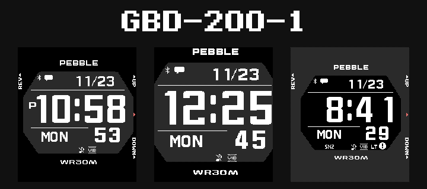

# GBD-200-1



A Pebble Time 2 / Pebble 2 Duo watchface recreating the main time display of the Casio
G-SHOCK GBD-200, dot for dot. Not affiliated with or endorsed by Casio.

## How it's made

Every glyph is a bitmap of the real watch's LCD dots, traced from photos
(perspective-corrected and sampled at the dot centers), and drawn at the
dot positions measured from a straight-on product shot. Glyphs live as
ASCII art in `tools/gen_glyphs.py`, which generates `src/c/glyphs.auto.h`.

Non-integer scales (Real size is 110%) mean some dots must be 2 pixels wide.
`tools/scale_plan.py` picks which columns and rows those are, per glyph
family and scale, to keep same-width strokes the same width.

## Building

```sh
python3 tools/gen_glyphs.py   # after editing glyphs or the panel outline
pebble build
pebble install --emulator emery
```

Store assets are in `store/`. `python3 tools/make_banner.py` rebuilds the
banner from `store/screenshots/`, and `python3 tools/make_icon.py` the
watchface-list icon.

## Features

- Display size: Real size (110%), Original (1:1), Fill width, or custom
- Seconds, temperature (from the Pebble app's weather plugin), or off
- DST indicator or time zone abbreviation
- Automatic alarm and low-battery icons; optional SNZ / VIB / LT / mute /
  airplane icons
- Button labels, PEBBLE / WR30M case text, and the octagon LCD panel

## License

MIT, see [LICENSE](LICENSE).
